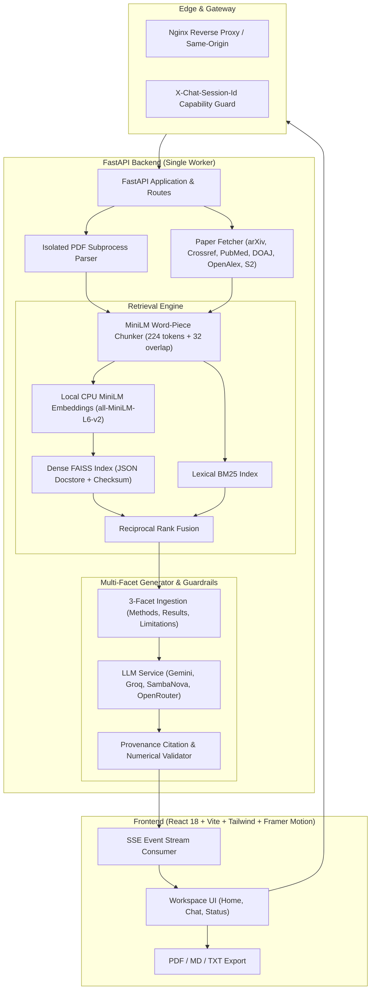

# ResearchPaperRAG

[](LICENSE)
[](https://www.python.org/)
[](https://nodejs.org/)
[](https://fastapi.tiangolo.com/)
[](https://react.dev/)
[](https://vitejs.dev/)

An autonomous, multi-source scientific literature discovery, comparative evidence extraction, and cited research gap analyzer. 

ResearchPaperRAG combines federated academic search across six registries with local PDF ingestion, tokenizer-aware document chunking, hybrid BM25 + dense FAISS rank fusion, multi-facet LLM synthesis, and deterministic evidence grounding.

---

## Architecture Overview



---

## Key Features

- **Federated Academic Search**: Query arXiv, Crossref, Semantic Scholar, OpenAlex, PubMed (with real structured abstracts via EFetch), and DOAJ concurrently. Discovery targets recent literature with dynamic calendar-year windows and transparent per-source error reporting.
- **Secure PDF Ingestion**: Upload up to 5 research papers or analyze fetched open-access PDFs. Parsing runs in an isolated disposable subprocess with memory/page limits (up to 200 pages, 500,000 characters) and strict SSRF download protection.
- **Tokenizer-Aware Chunking**: Uses embedding-specific word pieces (224 word pieces + 32-token overlap, bounded safely below MiniLM's 256-token limit) preserving section and page provenance.
- **Hybrid Dense + Lexical Retrieval**: Combines local CPU FAISS vector search with independent BM25 lexical ranking across the full session corpus, recovering exact acronyms, dataset identifiers, and numerical parameters.
- **Deterministic Evidence Grounding**: Validates citation identifiers (`[E1]`, `[E2]`), verifies cited claim presence, and cross-checks numerical literals against retrieved source passages and publication metadata before streaming completion.
- **Real-Time Progress Streaming**: Server-Sent Events (SSE) report live preparation milestones, extraction phases, drafted sections, elapsed duration, and estimated completion time.
- **Follow-Up Research Chat**: Ask focused follow-up questions with conversational context scoping, server-side context clearing (`DELETE /api/chat/followup`), and citation verification.
- **Multi-Format Export**: Export comprehensive literature reports as formatted PDF (print-ready layout), GitHub Markdown, or plain text.
- **Editorial Design System**: Responsive light and dark themes with paper-like contrast, native keyboard navigation, visible focus indicators, and reduced-motion support.
- **Safe Persistence**: FAISS docstores serialize with native JSON and SHA-256 checksums rather than Python pickle files, preventing arbitrary code execution.

---

## Curated Model Catalog

ResearchPaperRAG provides a unified catalog of 17 reviewed models across 6 providers. Defaults prioritize free-tier availability:

| Provider | Access Tier | Reviewed Model IDs | Notes |
|---|---|---|---|
| **Google Gemini** | Free Tier | `gemini-3.8-flash` *(Default)*<br>`gemini-3.5-flash-lite` | High throughput, reasoning-effort control, zero prompt charges on standard free tier. |
| **Groq** | Free Tier | `openai/gpt-oss-120b`<br>`openai/gpt-oss-20b`<br>`qwen/qwen3.8-27b` | Ultra-fast LPU inference, structured outputs. |
| **SambaNova** | Free Tier | `DeepSeek-V3.1`<br>`Meta-Llama-3.3-70B-Instruct`<br>`gpt-oss-120b`<br>`DeepSeek-V3.2` *(Preview)*<br>`gemma-4-31B-it` *(Preview)* | Generous token rate limits on hosted open models. |
| **OpenRouter** | Free Tier | `openrouter/free`<br>`google/gemma-4-31b-it:free`<br>`google/gemma-4-26b-a4b-it:free`<br>`nvidia/nemotron-3.5-lightning:free` | Aggregated free community endpoints. |
| **Cerebras** | Trial Credit | `qwen-3.8-27b` | Requires credit; disabled by default unless configured. |
| **Hugging Face** | Credits | `Qwen/Qwen3.8-27B`<br>`google/gemma-4-31B-it` | Router endpoints for purchased inference credits. |

> **Credit Safeguard**: `ALLOW_CREDIT_PROVIDERS=false` by default. Adding a Cerebras or Hugging Face token will not enroll paid models into failover unless `ALLOW_CREDIT_PROVIDERS=true` is explicitly enabled.

---

## Configuration & Operational Parameters

All backend configuration is managed via environment variables (see `backend/.env.example`):

| Variable | Default | Description |
|---|---|---|
| `DEFAULT_PROVIDER` | `gemini` | Primary LLM provider (`gemini`, `groq`, `sambanova`, `openrouter`). |
| `DEFAULT_MODEL` | `gemini-3.8-flash` | Primary model identifier. |
| `CONTEXT_TOKEN_BUDGET` | `4000` | Estimated token budget allocated for retrieved passage evidence. |
| `REPORT_MAX_TOKENS` | `3500` | Maximum completion token ceiling for gap analysis reports. |
| `FOLLOWUP_MAX_TOKENS` | `800` | Maximum completion token ceiling for follow-up responses. |
| `LLM_MAX_ATTEMPTS` | `3` | Maximum failover/retry attempts across providers. |
| `LLM_TIMEOUT_SECONDS` | `30` | Per-attempt network request timeout. |
| `LLM_REQUEST_DEADLINE_SECONDS` | `60` | Cumulative execution deadline before request abort. |
| `MAX_CONCURRENT_REQUESTS` | `4` | Process-wide concurrency throttle for intensive LLM calls. |
| `MAX_PDF_PAGES` | `200` | Maximum page cutoff for uploaded/fetched PDF processing. |
| `MAX_EXTRACTED_CHARS` | `500000` | Maximum cumulative text character extraction limit per document. |
| `MAX_DOCUMENT_CHUNKS` | `1000` | Maximum chunks indexed per research session. |
| `EMBEDDING_USE_REMOTE` | `false` | Use local CPU MiniLM (`all-MiniLM-L6-v2`) when `false`. |
| `ALLOW_CREDIT_PROVIDERS` | `false` | Prevent accidental billing on trial/paid provider endpoints. |
| `TRUSTED_PROXY_IPS` | `""` | Comma-separated trusted immediate upstream proxy IPs/CIDRs. |
| `CORS_ORIGINS` | `*` | Allowed CORS origins for frontend client communication. |

---

## Quickstart & Local Setup

### Prerequisites

- **Python**: 3.12+ (tested up to 3.14)
- **Node.js**: >=22.13 LTS (Node 24 recommended)
- At least one free API key (e.g. [Google AI Studio](https://aistudio.google.com/apikey) or [Groq Console](https://console.groq.com/keys)).

### 1. Backend Setup

From the repository root:

```bash
# Create and activate virtual environment
python -m venv .venv
source .venv/bin/activate  # On Windows PowerShell: .venv\Scripts\Activate.ps1

# Install backend dependencies
pip install -r backend/requirements-dev.txt

# Configure environment
cp backend/.env.example backend/.env  # On Windows: Copy-Item backend/.env.example backend/.env
```

Edit `backend/.env` to supply your API key (e.g., `GOOGLE_API_KEY=your_key_here`).

Start the backend API server:

```bash
python -m uvicorn backend.app.main:app --host 127.0.0.1 --port 8000 --no-proxy-headers
```

> **Note on First Run**: The local CPU embedding model (`sentence-transformers/all-MiniLM-L6-v2`) downloads automatically on first ingestion. Embeddings run entirely on CPU in batches of 16 without consuming external API credits.

### 2. Frontend Setup

In a separate terminal:

```bash
cd frontend
npm ci
npm run dev
```

Open `http://localhost:5173` in your browser. The frontend automatically proxies `/api/` calls to `http://127.0.0.1:8000`.

---

## Deployment Options

### Option A: Hugging Face Spaces (Backend)

Upload the contents of the `backend/` directory directly to your Hugging Face Gradio Space:

1. Create a new Space on [Hugging Face](https://huggingface.co/new-space) using the **Gradio** SDK.
2. Upload all files from the `backend/` directory into the root of the Space repository (`app.py`, `app/`, `requirements.txt`, `README.md`, etc.).
3. Configure your provider keys (e.g., `GOOGLE_API_KEY`) under **Settings → Variables and Secrets**.
4. Set `CORS_ORIGINS` to your frontend's deployment URL (e.g. `https://your-app.pages.dev`).

The Space will automatically run the FastAPI backend and expose a status interface at `/gradio/`.

### Option B: Cloudflare Pages (Frontend)

Deploy the frontend with zero server maintenance:

1. **Direct Drag-and-Drop**:
   - Set `VITE_API_BASE_URL=https://your-space.hf.space` in `frontend/.env.local`.
   - Run `npm run build` inside `frontend/`.
   - Drag and drop the resulting **`frontend/dist`** folder directly into Cloudflare Pages Direct Upload.
2. **Git Integration**:
   - Connect your GitHub repository to Cloudflare Pages.
   - Set Root directory to `frontend`.
   - Build command: `npm run build`.
   - Output directory: `dist`.
   - Set the environment variable `VITE_API_BASE_URL` in the Pages project settings.

See [docs/HOSTED_DEPLOYMENT.md](docs/HOSTED_DEPLOYMENT.md) for full hosted instructions.

### Option C: Docker & Docker Compose

Deploy the complete multi-container stack locally or on a VPS:

```bash
docker compose --env-file backend/.env up --build -d
```

- **Frontend**: Available on port `80` (and `5173`).
- **Backend API**: Bound internally to `8000` with single-worker isolation.
- Built with CPU-only PyTorch to minimize image footprint and avoid GPU dependencies.

---

## Verification & Testing

Run all quality checks across backend and frontend:

```bash
# Backend unit tests (73 tests covering isolation, SSRF, parser, and grounding)
python -B -m unittest discover -s backend/tests -p "test_*.py"

# Backend static analysis and type checks
python -m ruff check backend/app
python -m mypy backend/app

# Frontend static analysis, type checking, security tests, and build
npm --prefix frontend run lint
npm --prefix frontend run typecheck
npm --prefix frontend run test:security
npm --prefix frontend run build
```

---

## Security & Operational Safeguards

- **Capability-Based Sessions**: Document indexing and research state are protected by unguessable UUID v4 `X-Chat-Session-Id` headers.
- **SSRF Defense**: The backend blocks loopback, link-local, private RFC 1918 addresses, nonstandard ports, and credential injection during PDF retrieval.
- **Process Isolation**: PDF parsing is isolated in a disposable worker process with a 30-second hard timeout and page/character quotas.
- **Sanitized Telemetry**: Client error reports require an explicit Sentry DSN; research queries, documents, answers, and session IDs are stripped before telemetry transmission.
- **Pickle-Free Storage**: FAISS vector indices store document text and metadata as native JSON with SHA-256 integrity checks.

---

## Detailed Documentation

- [API Specification & Examples](docs/API.md) — Complete endpoint reference, payload structures, and SSE schemas.
- [Production Deployment Guide](docs/DEPLOYMENT.md) — Single-worker sizing, reverse proxy settings, and operational limits.
- [Hosted Deployment Guide](docs/HOSTED_DEPLOYMENT.md) — Step-by-step Hugging Face + Cloudflare Pages walk-through.
- [Feature Architecture Map](docs/FEATURES.md) — Component breakdown and pipeline implementation details.
- [Testing & Quality Assurance](docs/TESTING.md) — Test suites, security assertions, and browser integration.
- [Backend Gradio & Spaces Reference](backend/README.md) — Optional legacy PDF chat and Spaces configuration.

---

## License

This project is licensed under the MIT License — see the [LICENSE](LICENSE) file for details.
